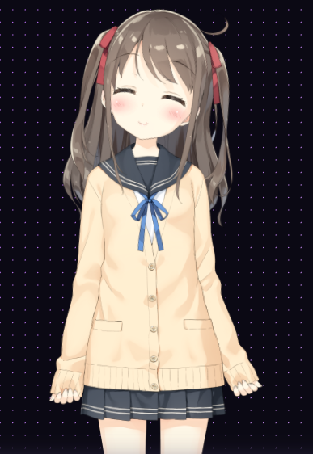

<div align="center">
  <a href="https://github.com/ar0x1/AURA">
    
  </a>

  <h1>AURA</h1>
  <p><strong>Your personal AI companion, brought to life with Live2D.</strong></p>
  <p>Real-time conversations · Expressive characters · Natural voice · Personalization</p>

  <p>
    <a href="https://itsaura.ai.studio/app/">
      
    </a>
    <a href="https://itsaura.ai.studio/">
      
    </a>
    <a href="https://github.com/ar0x1/AURA">
      
    </a>
    <a href="https://github.com/ar0x1/AURA/issues">
      
    </a>
  </p>

  <p>
    
    
    
    
  </p>

  <a href="https://itsaura.ai.studio/">
    
  </a>
</div>

---

## Overview

**AURA** is a free, open-source, browser-based AI companion designed to make conversations feel more alive. It combines configurable AI responses with animated **Live2D characters**, expressive text-to-speech, conversation memory, and a customizable interface.

Run it locally with a lightweight Node.js server, connect your preferred AI provider, choose a character, and make the experience your own.

## Features

### AI conversation
- **OpenRouter integration** with a configurable primary model and up to two model fallbacks.
- **Streaming responses** for a more responsive chat experience.
- **Server-side fallback:** the Express server can use NVIDIA Nemotron, then Gemini when configured, before falling back to a local response.
- **Custom personas:** shape a companion's personality and behavior with editable prompts.
- **Conversation context:** configurable memory depth and rolling conversation summaries.
- **Context awareness:** optionally include information such as the current time and device battery status.

### Live2D characters
- **Live2D Cubism rendering** powered by PIXI.js and `pixi-live2d-display`.
- **Character gallery** for browsing and switching between available models.
- **Custom model loading** using a Live2D `.model3.json` URL.
- **Multiple model support** when enabled.
- **Interactive character controls:** drag, reposition, and zoom models.
- **Animated expressions and idle motion**, including emotion-linked facial changes and particle effects.

### Voice and audio
- **AURA TTS:** Fish Audio integration through the local server's protected API proxy.
- **Expressive speech playback** with sentence chunking and audio preloading.
- **Live2D lip-sync** driven by audio frequency analysis.
- **Voice controls** for enabling speech and adjusting playback volume.

### Personalization and controls
- Customizable backgrounds and a background library.
- Adjustable chat layout, panel opacity, and display preferences.
- Multi-language interface and response-language options.
- Optional ambient conversation and message queue features.
- Debug panel with categorized application logs.
- Guided in-app tutorial for getting familiar with the controls.

## Quick Start

### Requirements

- **Node.js 20 or newer** and npm.
- A modern browser such as Chrome, Firefox, or Edge.
- An internet connection for external AI, voice, and model assets.

### 1. Clone the repository

```bash
git clone https://github.com/ar0x1/AURA.git
cd AURA
```

### 2. Install dependencies

```bash
npm install
```

### 3. Configure environment variables

Create a `.env` file in the project root:

```bash
touch .env
```

Add the provider keys you intend to use:

```env
# Server-side AI provider (optional, but recommended for the server fallback)
NVIDIA_API_KEY=your_nvidia_api_key

# Optional NVIDIA endpoint/model overrides
# NVIDIA_BASE_URL=https://integrate.api.nvidia.com/v1
# NVIDIA_MODEL=nvidia/nemotron-3.5-lightning-30b-a3b

# Optional Gemini fallback for the server-side chat route
GEMINI_API_KEY=your_gemini_api_key

# Fish Audio key enables server-proxied AURA voice generation
FISH_AUDIO_API_KEY=your_fish_audio_api_key

# Optional Fish Audio model/reference overrides
# FISH_AUDIO_MODEL=s2.1-pro-free
# FISH_AUDIO_REFERENCE_ID=your_reference_id
```

> **Security:** Never commit your `.env` file or paste API keys into a public issue. Make sure `.env` is listed in your `.gitignore` before committing changes.

**Provider notes**

- The app's OpenRouter integration reads its API key and model preferences from browser storage. It supports a primary model and up to two fallback models.
- `NVIDIA_API_KEY` enables the server-side NVIDIA chat fallback. The current default model is `nvidia/nemotron-3.5-lightning-30b-a3b`.
- `GEMINI_API_KEY` is optional and is used as a secondary server-side fallback when the NVIDIA request is unavailable.
- `FISH_AUDIO_API_KEY` is required for the server's Fish Audio TTS endpoint. Without it, Fish Audio requests return an API-key configuration error.

### 4. Start AURA

Development mode:

```bash
npm run dev
```

Or start the server normally:

```bash
npm start
```

### 5. Open the app

- Landing page: <http://localhost:3000>
- AURA app: <http://localhost:3000/app/>
- Server health check: <http://localhost:3000/api/health>

The server currently listens on port **3000**.

## Using AURA

1. Open the app using the local URL or the **Launch AURA App** button above.
2. Open **Settings** to explore character, voice, language, and display preferences.
3. Open **Models & Visuals → Character Gallery** to browse available Live2D characters.
4. Choose **Voice & Audio** to enable speech and adjust the voice volume.
5. Customize the companion persona and conversation preferences, then start chatting.
6. Open the debug panel when troubleshooting AI, audio, or model-loading issues.

## AI and Voice Architecture

AURA uses two related paths:

| Component | Provider / behavior | Configuration |
|---|---|---|
| Main browser chat | OpenRouter, with a primary model and up to two model fallbacks | OpenRouter key and model preferences are stored in browser storage |
| Server chat fallback | NVIDIA Nemotron, then Gemini if configured, then a local response | `NVIDIA_API_KEY`, optional `NVIDIA_MODEL`, `NVIDIA_BASE_URL`, and `GEMINI_API_KEY` |
| Voice generation | Fish Audio through the Express server proxy | `FISH_AUDIO_API_KEY`, optional `FISH_AUDIO_MODEL` and `FISH_AUDIO_REFERENCE_ID` |
| Character animation | Live2D Cubism rendered with PIXI.js | Select a model in the Character Gallery or provide a custom model URL |

The server exposes a health endpoint at `/api/health`, chat endpoints at `/api/chat` and `/api/chat/stream`, and Fish Audio endpoints at `/api/tts`, `/api/tts/fish`, and `/api/tts/stream`.

## Development Commands

| Command | Description |
|---|---|
| `npm run dev` | Start the Express server for development |
| `npm start` | Start the Express server |
| `npm test` | Run the Node.js test suite |
| `npm run lint` | Run the server JavaScript syntax check |

## Project Structure

```text
AURA/
├── app/          # Browser application, scripts, and styles
├── assets/       # Application artwork and visual assets
├── test/         # Automated tests
├── server.js     # Express server and API routes
├── index.html    # Landing page
├── package.json  # Dependencies and npm scripts
├── favicon.png   # Repository/application icon
├── favicon.ico
└── LICENSE       # MIT-0 license
```

## Tech Stack

- **JavaScript (ES modules)** — application and server logic.
- **Node.js + Express** — local web server and API endpoints.
- **Live2D Cubism SDK** — character rendering and animation.
- **PIXI.js + pixi-live2d-display** — 2D rendering layer for Live2D models.
- **OpenRouter** — configurable browser-side LLM integration.
- **NVIDIA Nemotron + Google Gemini** — optional server-side chat and fallback providers.
- **Fish Audio** — voice synthesis integration.
- **Day.js** — date and time utilities.

## Troubleshooting

### The page does not load

Make sure the server is running and open `http://localhost:3000`. Do not open the HTML files directly with `file://`; use the Node server so API requests and browser security rules work correctly.

### Chat uses a fallback response

Check that your OpenRouter configuration is valid. For the server-side fallback, verify `NVIDIA_API_KEY` and, optionally, `GEMINI_API_KEY` in `.env`, then restart the server.

### AURA voice is unavailable

Check that `FISH_AUDIO_API_KEY` is present in the server environment and restart AURA. You can inspect the TTS configuration status at `http://localhost:3000/api/tts/status`.

### A Live2D model does not appear

Check the browser console and the AURA debug panel. For a custom model, confirm that the `.model3.json` file and all referenced textures, motions, and other model assets are reachable.

## Contributing

Issues and pull requests are welcome. Before opening an issue, include the steps to reproduce the problem and any relevant browser-console or AURA debug messages. **Do not include API keys, tokens, or other secrets.**

- [Open an issue](https://github.com/ar0x1/AURA/issues)
- [Browse the source code](https://github.com/ar0x1/AURA)

## License

AURA is released under the **MIT No Attribution (MIT-0)** license. See [`LICENSE`](LICENSE) for the full license text.

---

<div align="center">
  <p>Built with care by <a href="https://github.com/ar0x1">ar0x</a>.</p>
  <p><a href="https://itsaura.ai.studio/app/">Launch AURA</a> · <a href="https://github.com/ar0x1/AURA">GitHub</a> · <a href="https://github.com/ar0x1/AURA/issues">Issues</a></p>
</div>
